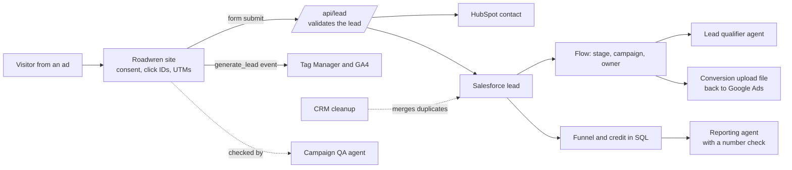

# revenue-stack-demo

A working marketing and revenue stack for a made-up company, built to show how I set up tracking, lead handling and AI automation. By Max Pickard.

Roadwren is a fictional fleet telematics company. Every person, customer and record in this repo is made up. The site, the tags, the CRM setup and the code are real and running.

- Live demo site: https://roadwren-demo.vercel.app
- My portfolio, with a write-up of each build: https://maxpickard-revenue-stack.vercel.app

## How the pieces connect



Solid arrows that end at HubSpot are live today. The Salesforce, agent, SQL and upload parts are in progress or planned, as the table below says.

## Status

Six builds, in the order a lead moves through them. Each has a write-up on [my portfolio](https://maxpickard-revenue-stack.vercel.app), made from the README in its folder.

| Build | Folders | Status |
|---|---|---|
| Tracked site: consent, click IDs, hidden fields, lead API, Tag Manager and GA4 | `site/`, [`tagging/`](tagging) | In progress. The site code is live |
| Salesforce routing: lead to campaign Flows, queues, one validation rule, and the conversion upload file for Google Ads | [`crm/salesforce/`](crm/salesforce), `pipelines/offline_conversions/` | In progress |
| Campaign QA agent: checks pages for tags, events, UTMs and consent before launch | [`agents/tracking_qa/`](agents/tracking_qa) | Planned |
| Lead qualifier agent: scores a lead, writes back to Salesforce, routes it | [`agents/lead_classifier/`](agents/lead_classifier) | Planned |
| Funnel and attribution in SQL, and a reporting agent with a number check | `pipelines/synthetic/`, [`warehouse/`](warehouse), `agents/analyst/` | Planned |
| CRM cleanup: duplicate accounts and contacts in Salesforce merged by script and graded | [`crm/salesforce_dedupe/`](crm/salesforce_dedupe) | Planned |

## What the site does today

- **Consent first.** All four consent mode signals are set to denied before the Tag Manager container loads. The banner updates them on choice and remembers the choice in a first-party cookie.
- **Click IDs and UTMs.** On landing it reads gclid, gbraid, wbraid, fbclid, li_fat_id, msclkid and the five UTM values. They are stored only after ad storage is granted. Before consent they are held in memory only.
- **Hidden fields.** Every form submit carries the click IDs, UTMs and the GA client ID, filled at submit time. They stay empty unless consent is granted.
- **One conversion event.** A successful submit pushes `generate_lead` with the form ID, form type and plan. The email is included for enhanced conversions and is the only personal data the data layer ever holds.
- **Lead API.** `/api/lead` validates the input and upserts a HubSpot contact. It never logs an email address. Empty fields are left out so a repeat lead cannot wipe a stored click ID.

Pages: home, pricing, demo form, thanks, privacy.

## Tests

Six unit test files cover the click ID parser, attribution storage, the consent gate on hidden fields, the GA client ID reader, the contact helper and the lead API. One browser test opens `/demo?gclid=TEST123`, accepts consent, submits, and checks the `generate_lead` push and the API payload.

```
cd site
npm install
npm test
npm run test:e2e
```

## The portfolio site

My portfolio is plain HTML in `proof/`. A short Python script builds it: the home page from `proof/generator/templates/home.html` and `proof/generator/builds.json`, and one write-up page per build from that build's README. After changing a README, run it and commit the pages.

```
pip install -r proof/generator/requirements.txt
python proof/generator/build.py
python -m unittest discover -s proof/generator -p "test_*.py"
```

GitHub runs the same tests on every pull request, and they fail if a page is out of date with its README.

## Decisions and limits

- Every trade-off is one line in [`docs/decisions.md`](docs/decisions.md): chose X over Y because Z, accepting T.
- The site spec is in [`docs/spec-site.md`](docs/spec-site.md). Pages in the spec that are not built yet are not listed above.
- No ad account is connected, so nothing here proves a live import into Google Ads.
- The data is made up. Real CRMs have messes this one does not.

## Run it

```
cd site
cp ../.env.example .env.local   # then fill in the values
npm install
npm run dev
```

`HUBSPOT_TOKEN` is optional. Without it the lead API validates the lead, logs one line and returns success without sending anything. `NEXT_PUBLIC_GTM_ID` is optional. Without a valid ID no container loads.

## Who wrote what

I design and run this. Claude Code writes most of the code from my specs. The tests, the answer keys and the decisions file are how I check the result.

## Not in this repo

Client names, client data and anything from my employer. The one exception is the portfolio home page, which names where I work. Secrets live in environment variables and a pre-commit hook blocks commits that contain one.
